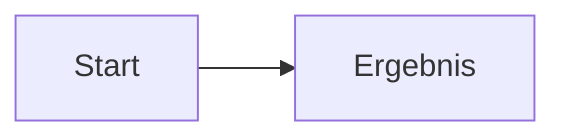
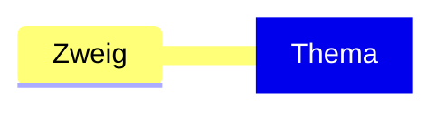

# Allgemeine Einstellungen

Unter **Einstellungen → Emergence** liegen die Sprache und die fünf Bereiche Graph, Feldideen, Mermaid, Argdown und Suche. Die Modell-, Beziehungs-, Profil- und Datenkonfiguration bleibt unter Feldideen.

## Bereiche aktivieren

Jeder Bereich hat einen eigenen nativen Schalter **Aktiviert**. Eine Änderung wird unabhängig von anderen Einstellungsentwürfen gespeichert. Verwerfen eines Graph- oder Modell-Entwurfs setzt den Aktivierungsschalter nicht zurück.

Deaktivierte Register, ihre spezifischen Befehle und Diagramm-Bearbeitungsaktionen werden ausgeblendet. Die Tastaturnavigation überspringt diese Register; die verbleibenden Register nutzen die verfügbare Breite. Wird der aktuelle Bereich ausgeschaltet, öffnet sich der erste aktive Bereich. Sind alle ausgeschaltet, erscheint ein entsprechender Hinweis. Die Einstellungsseiten bleiben erreichbar. Einstellungen, eigene Vorlagen und bestehende Diagrammentwürfe samt Auswahl und Undo-Verlauf bleiben erhalten. Noch nicht geöffnete deaktivierte Editoren werden nicht aufgebaut.

Bei ausgeschaltetem Graphen bietet die Suche weiterhin **Öffnen**; **Erkunden** wird erst mit dem Graphen wieder verfügbar. Hintergrundaktualisierungen des Wissensgraphen pausieren, wenn Graph, Feldideen und Suche sämtlich deaktiviert sind. Vorlagenordner deaktivierter Editoren werden nicht gelesen. Das Anzeigen bereits gespeicherter Diagramme in Notizen bleibt vom Zugriff auf ihre Editoren getrennt.

## Graph-Vorschau

Die anklickbare Vorschau verwendet den tatsächlichen Graph-Renderer mit synthetischen Beispieldaten. Es werden keine Notizinhalte dafür gelesen. Eine Überschrift wählt den darunterliegenden Einstellungsbereich aus. Dort lassen sich festlegen:

- eine eigene Überschrift; leer verwendet die bisherige, übersetzbare Vorgabe;
- Position **Oben**, **Links**, **Rechts**, **Unten**, **Liste unter dem Graphen** oder **Ausgeblendet**;
- Reihenfolge innerhalb einer Position, per Ziehen oder über die Pfeilschaltflächen;
- Tiefe 1, 2, 3 oder alle erreichbaren Ebenen;
- zugeordnete Breadcrumbs-Felder. Literatur kann außerdem aus ZotLit stammen; freie Verweise kommen aus dem Notiztext.

Überschriften lassen sich auf andere Überschriften oder auf die beschrifteten Zielbereiche unter der Vorschau ziehen. Die Positionsauswahl und Reihenfolgeschaltflächen bieten dieselben Änderungen ohne Ziehen. Ausgeblendete Zweige bleiben im Auswahlmenü verfügbar.

Die Anordnung verändert die Darstellung und nicht die fachliche Beziehung. Eine nach rechts verschobene Überordnung bleibt eine Überordnung; Breadcrumbs-Feldnamen und Properties werden nicht umbenannt. Die bisherige Zuordnung und Anordnung gelten weiter, solange sie nicht verändert werden. **Graph-Darstellung zurücksetzen** setzt Überschriften, Positionen, Reihenfolge und Tiefen zurück und erhält Feldzuordnungen. Änderungen gehören zum gemeinsamen Einstellungsentwurf und werden erst mit **Änderungen speichern** übernommen.

## Mermaid- und Argdown-Vorlagenordner

Jeder Editor kann einen eigenen vorhandenen Ordner im Vault verwenden. Die native Ordnerauswahl unterstützt Vorschläge. Leer verwendet die bisherige interne Bibliothek. Fehlt ein eingetragener Ordner, wird dies angezeigt; die bisherigen Bibliotheksvorlagen bleiben verfügbar.

Gelesen werden Markdown-Dateien im gewählten Ordner und seinen Unterordnern. Versteckte Ordner und Obsidians Konfigurationsordner sind ausgeschlossen. Eine Notiz kann mehrere passende Codeblöcke enthalten:

````markdown
# Kleines Flowchart



# Zweites Diagramm


````

Mermaid verwendet `mermaid`-Blöcke, Argdown `argdown`- oder `argdown-map`-Blöcke. Die vorangehende Markdown-Überschrift und der Dateiname bilden den Vorlagennamen; Überschriften innerhalb eines Codeblocks zählen nicht mit. Längere Backtick-Zäune, Tilden und CRLF werden unterstützt. Mehrere Diagramme unter derselben Überschrift erhalten einen Zähler.

Vorlagen erscheinen direkt im bestehenden Menü **Neu**, neben mitgelieferten und internen eigenen Vorlagen. Hover-Vorschau, Favoriten, Öffnen und Einfügen funktionieren weiterhin. Das Notizsymbol öffnet die Quelldatei am Codeblock. Der Papierkorb blendet eine Ordner-Vorlage aus der Bibliothek aus, ohne die Notiz zu löschen; die Bibliotheks-Rücknahme kann dies wiederherstellen. Änderungen und Entfernen der Quelldatei werden automatisch übernommen. **Vorlagen aktualisieren** liest den Ordner erneut.

Mit **Aktuelles Diagramm als Vorlage speichern** wird bei gewähltem Ordner eine neue Markdown-Datei mit passendem Codeblock angelegt. Namenskollisionen erhalten einen Zahlenzusatz; bestehende Dateien werden nicht überschrieben. Ohne Ordner bleibt die bisherige Speicherung in den Plugin-Daten bestehen. Ordnerinhalte werden nicht zusätzlich in `data.json` kopiert. Die Kennung einer Ordner-Vorlage basiert auf Pfad, vorangehender Überschrift und Vorkommensnummer; reine Codeänderungen erhalten ihre Favoritenzuordnung.

## Sprache

**Obsidian folgen**, **Deutsch** und **English** wirken sofort. Bestehende CodeMirror-Instanzen, Quelltexte, Auswahl und Rückgängig-Verläufe werden erhalten. Eigene Überschriften, Feldnamen, Notizen, Profile und Vorlagen werden nicht übersetzt. Die KI-Ausgabesprache bleibt unabhängig. Aufbau der lokalen Übersetzungen: [Lokalisierung](LOCALIZATION.md).
